# Rent Well: NewWorkOrderScreen audit

Mobile Development assignment. I audited the tenant "Report an Issue" screen (`features/workOrders/screens/NewWorkOrderScreen.js`, it was `screens/NewWorkOrderScreen.js` when I did the audit) on two device sizes and in two orientations, then fixed what broke.

## Devices tested
- Small phone: iPhone 18 Pro (iOS simulator)
- Tablet: iPad (iOS simulator)
- Portrait and landscape on each

## What I found and fixed

### 1. Safe area insets
The app hides the navigation header, so nothing kept the screen clear of the notch, status bar, or home indicator, and the title was pressed against the top. I used `useSafeAreaInsets` from `react-native-safe-area-context` and added each inset to the screen's normal padding. The top and bottom insets clear the status bar and home indicator, and the left and right insets keep content away from the notch in landscape.

### 2. Keyboard handling
The form was a plain `View`, so the keyboard could cover the Details field and the Submit button with no way to scroll to them. I wrapped the form in a `KeyboardAvoidingView` with a `ScrollView` inside, so the screen makes room for the keyboard and every field can be reached. `keyboardShouldPersistTaps="handled"` lets a tap on a chip or button work on the first try while the keyboard is open.

### 3. Layout with useWindowDimensions
On the iPad the form stretched edge to edge, and in landscape on the iPhone 18 Pro the photo preview took up most of the short screen. I capped the form at 600 wide and centered it so it reads like a phone layout on a tablet. I used `useWindowDimensions` to check whether the screen is wider than it is tall, and in that case the photo preview shrinks from 160 to 120 tall.

### Platform.OS
I used `Platform.OS` for the `KeyboardAvoidingView` behavior. iOS does not resize the app when the keyboard opens, so it needs `padding`, while Android already moves the content up on its own, so the behavior is left unset there (this follows the Expo keyboard handling guide).

### Other changes
Before these three fixes, I made two smaller changes: a first version of the top inset fix for the title, and a fix for the property chip row, which was stretching to fill the spare height and making the chips too tall (setting `flexGrow: 0` on it keeps it only as tall as the chips).

## Screenshots

| Condition | Before | After |
| --- | --- | --- |
| Phone portrait | 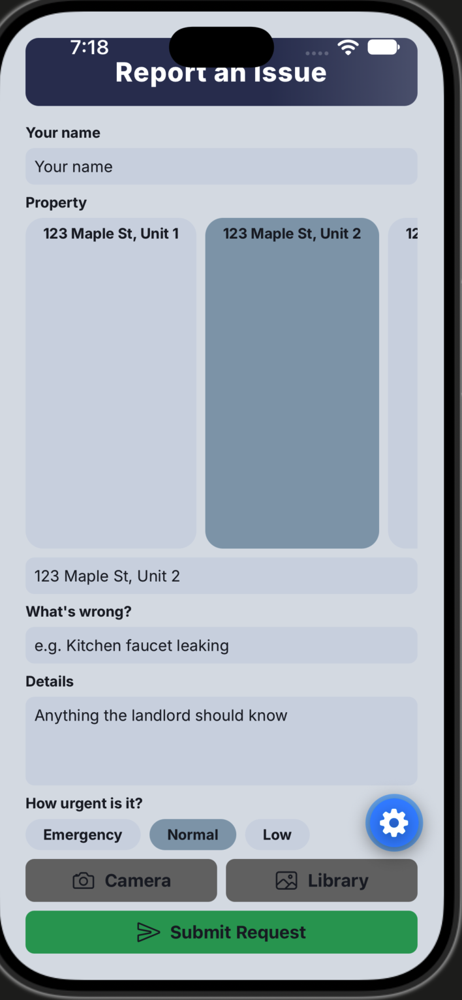 | 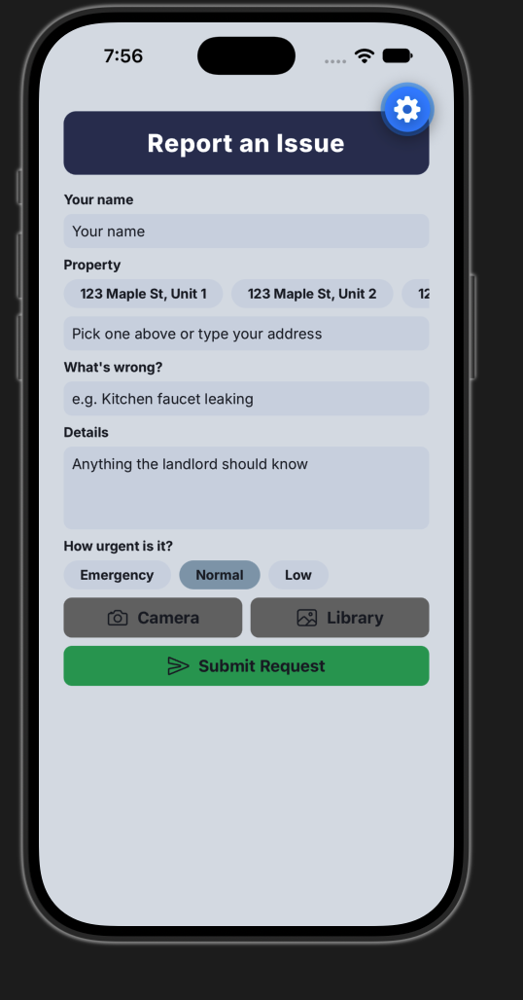 |
| Phone landscape | 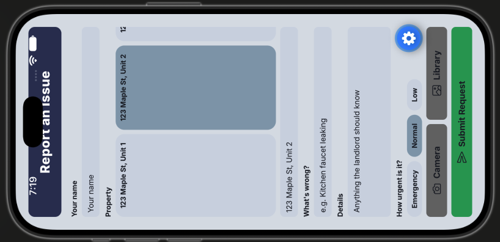 | 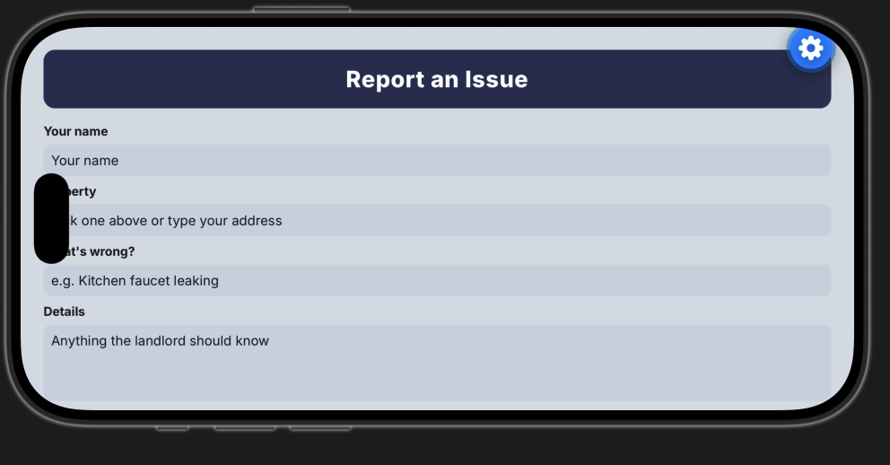 |
| iPad portrait | 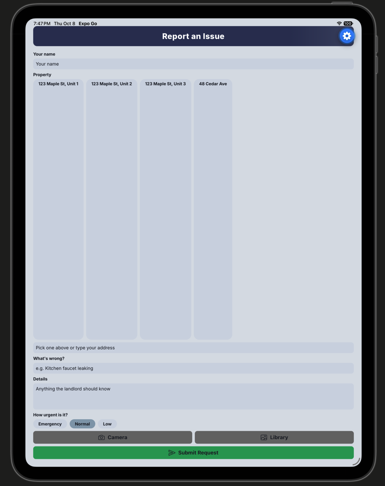 | 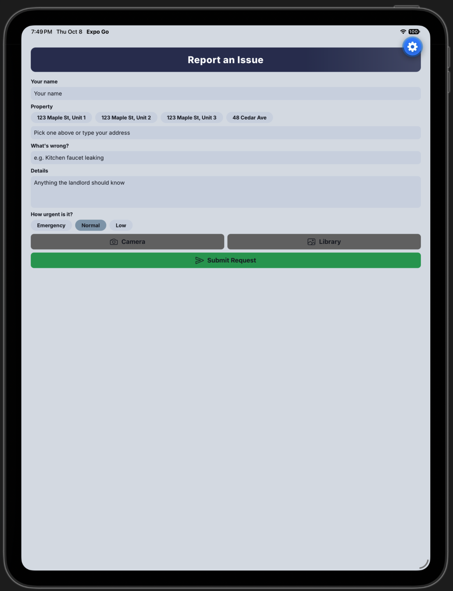 |
| iPad landscape | 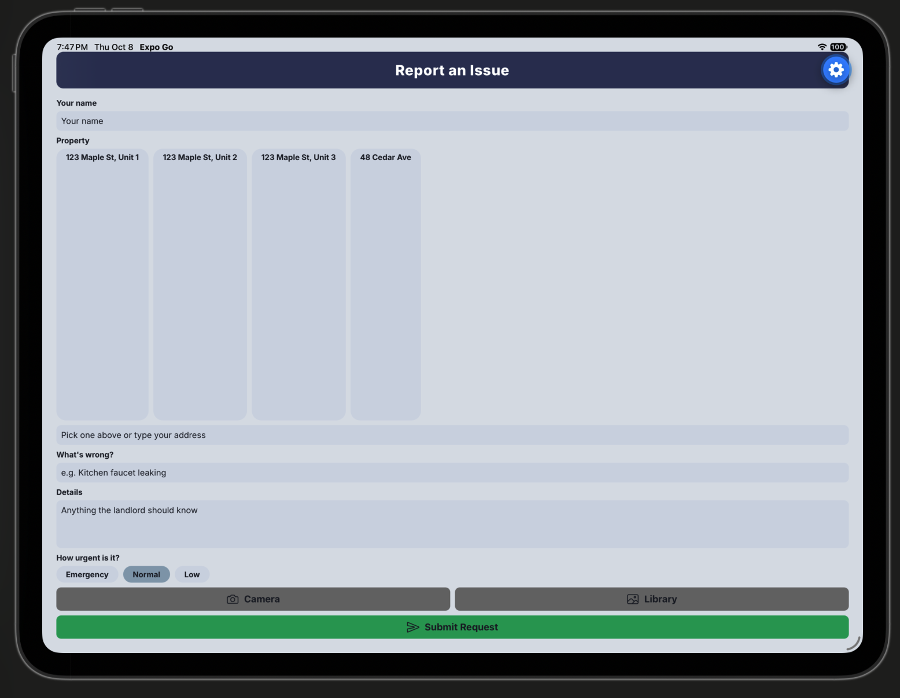 | 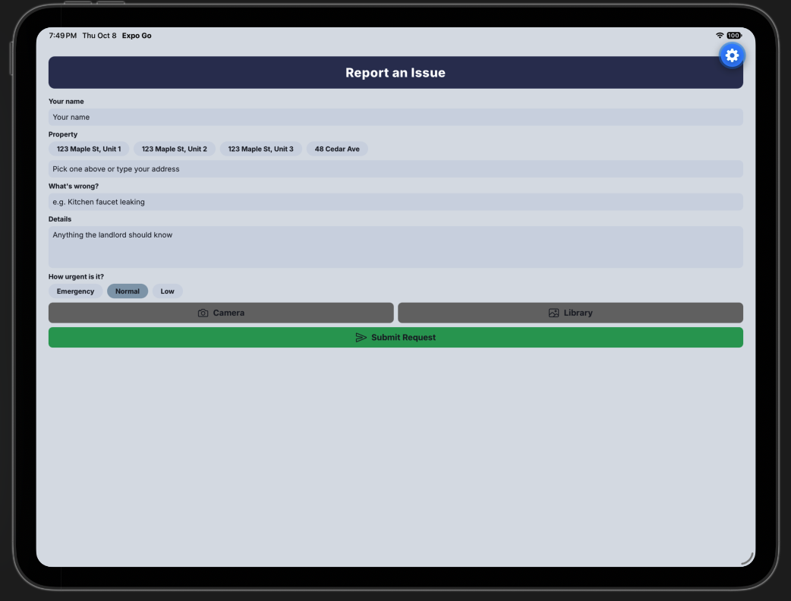 |

## Run it
```bash
npm install
npx expo start -c
```

## Backend: Firebase Realtime Database
Rent Well's only backend is a Firebase Realtime Database, used through its REST endpoints with plain
`fetch`. The demo needs no backend at all. Signing in, signing up, and everything a real account sees
read and write the database.

Setup, step by step: [docs/firebase-setup.md](docs/firebase-setup.md). The short version:

1. Create a Firebase project, then a Realtime Database in test mode.
2. Copy `.env.example` to `.env` and set `EXPO_PUBLIC_FIREBASE_DB_URL` to your database address
   (like `https://your-project-default-rtdb.firebaseio.com`, no slash at the end). `.env` is git
   ignored, so the address never gets committed. `EXPO_PUBLIC_FIREBASE_API_KEY` can stay blank for now.
3. Paste `database.rules.json` into the console's Rules tab and publish.
4. Fill the database: `npm run firebase:seed`, then check it with `npm run firebase:check`.
5. Start the app with `npx expo start -c` (the `-c` picks up a changed `.env`).

Signing in: Firebase Auth comes next milestone, so Log In lists the **test accounts** in the database
and you pick one (Taylor Brooks is the landlord, Sam Rivera a tenant, Morgan Diaz a former tenant,
Jamie Ortiz a landlord with no data yet). Sign up makes a new test account. For tenant sign up use the
invite code `K7M2QX9P`.

- **The data model:** [docs/data-model.md](docs/data-model.md), with the diagram
  [docs/data-model.png](docs/data-model.png).
- **Where the code is:** every database call is in `util/http.js` and the resource modules in
  `util/data/`. Shared state is React Context in `store/`.
- **No live updates over REST:** screens reload when they come back into view, on pull to refresh, and
  after every save. An open message thread checks for new messages every 8 seconds.
- **Rent billing:** the landlord's phone bills rent and late fees when the app opens, on pull to
  refresh of Payments, and after a rent schedule change. Each charge has a fixed id and is only
  created if it isn't there yet, so running it twice never double charges.
- **No photos yet:** the database can't hold files, so photos, receipts, and document files wait for
  Firebase Storage. Those buttons only show in the demo. Documents and checklists save their records.
- **No push notifications** in this milestone.
- **Trying it without your own project:** `npm run firebase:fake` starts a small local stand-in on
  port 9000. Seed it with `npm run firebase:seed -- --url=http://localhost:9000` and set `.env` to
  `http://localhost:9000` (on a phone, use the computer's address on the wifi).

The milestone 2 write-up is in [docs/project_journal.md](docs/project_journal.md).

## Payments and rent

A rent ledger for each tenancy, in both roles. Rent Well never takes payments: tenants pay the landlord directly (Zelle, check, and so on) and the app keeps the record.

- **Landlord:**
  - Payments and Rent shows a month at a time: collected against expected, overdue charges, claims to confirm or reject right from the list, and every tenant's balance.
  - A tenant's Rent Ledger has the balance, the next rent, the deposit held, and charges and payments by month. From there the landlord can record a payment or refund, add a charge, set the rent schedule (amount, due day, grace days, late fee, start date), and void with a reason.
  - Payment Record shows a timeline, the receipt photo, and Share Receipt (a text receipt).
  - Payment instructions live on Property Overview.
- **Tenant:**
  - What's due and the next rent date.
  - The landlord's payment instructions, with Copy.
  - "I Paid" sends a claim with an optional receipt photo. It shows "Waiting for confirmation" until the landlord confirms it, or shows the reason if they reject it.
  - History. Former tenants get it read only.
- **Both home screens** show a live line: "1 overdue" or "Rent due Nov 1: $1,450.00".
- **Money** is whole cents everywhere, so there's no float math.

Try it in the demo: as the landlord, open Payments and Rent, confirm Jordan's $75 claim, then open Sam's ledger and record a payment. As the tenant (Sam), tap I Paid. Then switch to the landlord view and confirm it.

With a Firebase account the ledger lives in the database (`charges`, `payments`, and `rentSchedules`), and the app works out every status and balance with the same ledger math the demo uses. New rent from a schedule is billed by the landlord's phone when the app opens, on pull to refresh, and right after a schedule change.

| Landlord | Rent Ledger | Tenant | Payment Record |
| --- | --- | --- | --- |
| 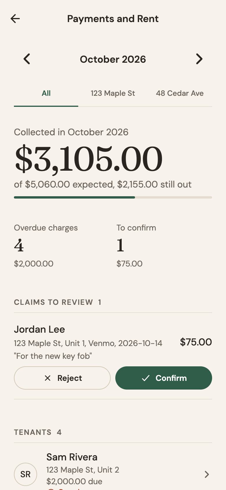 | 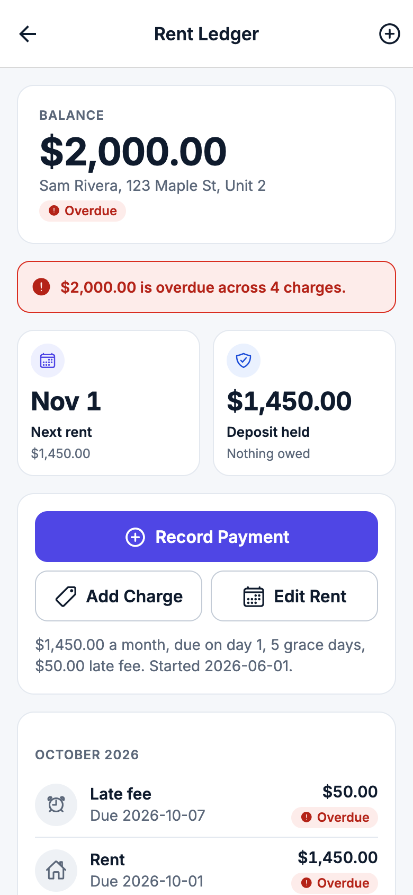 | 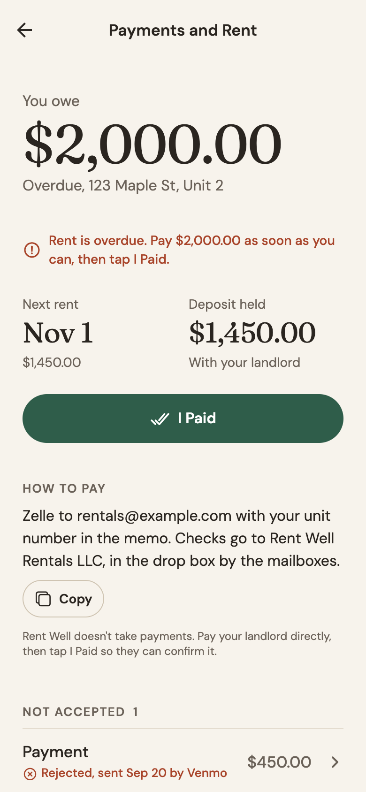 | 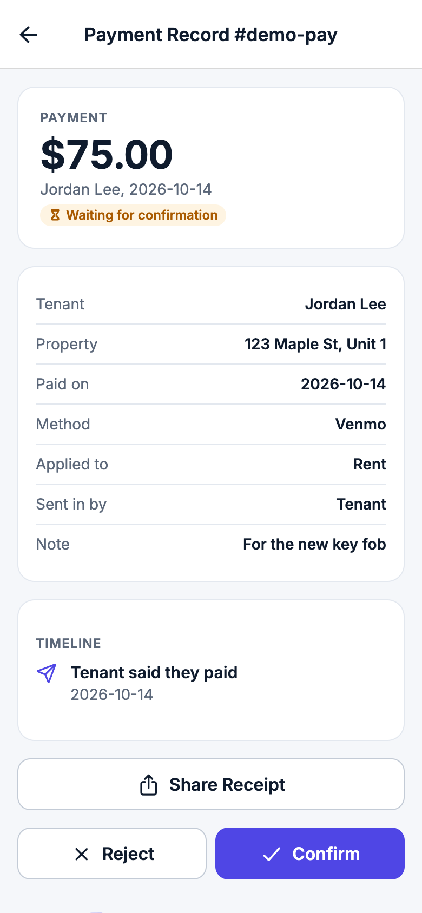 |

## The look

The app uses the Hearth design:
- warm paper and ink with one forest green for actions
- big Fraunces numbers
- hairline rows instead of cards

The full guide is in `docs/DESIGN.md`.

| Landlord home | Tenant home | Work orders | Messages |
| --- | --- | --- | --- |
| 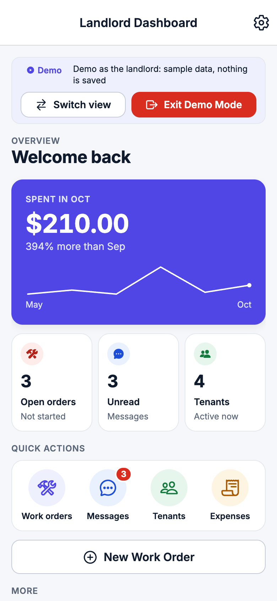 | 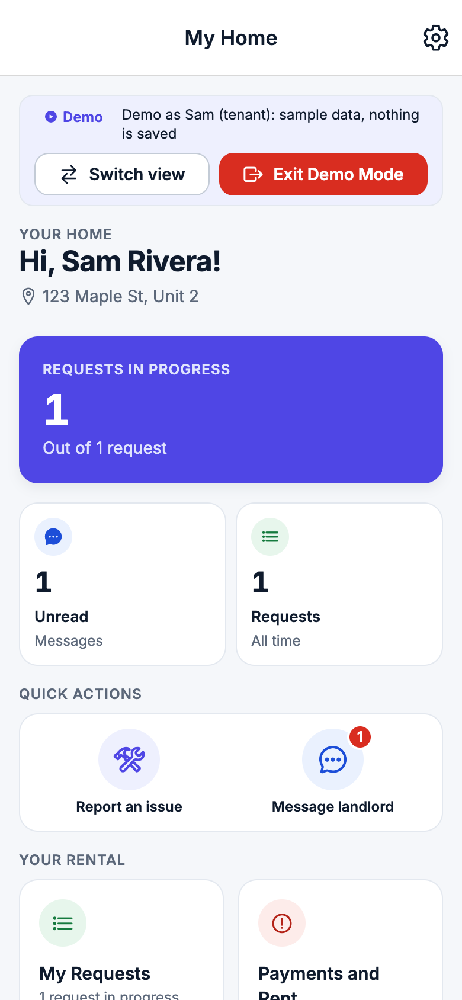 | 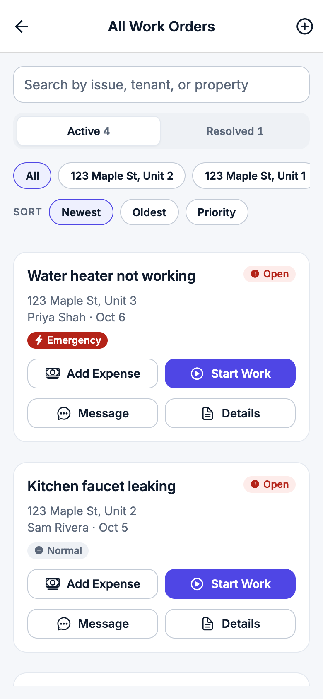 | 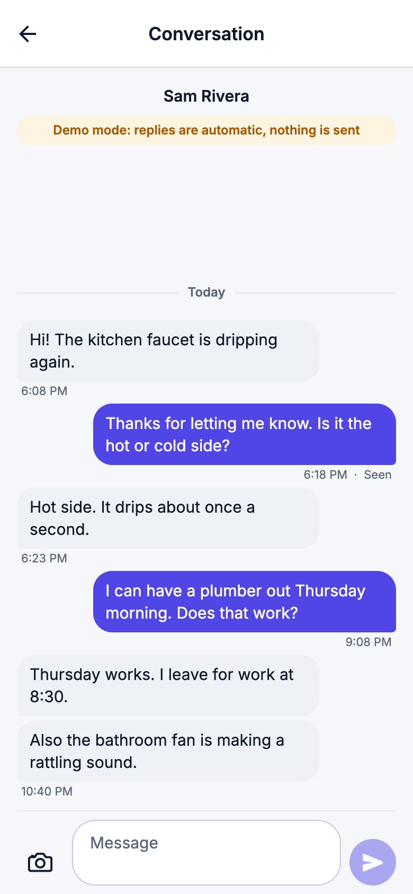 |

## Leases, profit, rent reminders, and dark mode

- **Leases:** the landlord drawer has Leases, every lease sorted by end date with its status (Active, Expiring soon, Expired, Month to month, No lease) and days left. A row opens that tenancy's lease, where Set, Edit, and Renew (with an optional new rent) open as sheets, under a history of every change. The Dashboard says how many end soon and shows a terracotta line when one ends within 30 days. Tenants see "Your lease ends Jan 15" on My Home within 90 days.
- **Expenses in Firebase:** a signed-in landlord's expenses live in the database (the demo keeps its own). The same screens work offline from a saved copy, and expenses saved only on this phone can be uploaded once with "Upload N expenses from this phone", which keeps anything that fails for another try.
- **Profit:** the drawer's Profit shows the year's net profit, rent collected and expenses, net by month as one green chart, and each property as a row (tap one to chart it). Tax Summary shares a Schedule E style summary as a CSV or text, from Profit or Expenses.
- **Rent reminders:** on an overdue tenant in Payments (Remind) or from the Rent Ledger's More sheet, pick Friendly or Overdue notice, edit the suggested text, and Send. It lands in the chat with a "Payment reminder" label that opens Payments for the tenant. One per tenant every 24 hours.
- **Dark mode:** Settings, Appearance: System, Light, or Dark, saved on the phone.

## Search, Calendar, and Face ID

- **Search:** the magnifying glass on Home and My Home searches everything the app already has loaded. A landlord finds tenants, properties, work orders, payments, charges, and expenses, and a tenant finds their own requests, payments, and charges. Results are grouped with the matching words highlighted, and a tap opens the screen that shows it. Recent searches are kept per account (memory only in the demo), with a Clear button.
- **Calendar:** in the drawer for both roles (Schedule). A month grid with dots for rent due dates, payments, lease ends, and work order dates, with a legend, and the day's agenda under it. Past due items are terracotta with an alert icon and the word Overdue. "Add to my calendar" sends one event or the next 90 days of rent and lease ends to the phone's calendar, in a "Rent Well" calendar, without doubles. The demo asks first and marks them "[Demo]".
- **Face ID or Touch ID:** Settings, Security turns on "Unlock with Face ID" for a signed-in account. Rent Well asks when it opens and after more than a minute away, with the passcode as a fallback and Log Out after three failed tries. The demo is never locked. Face ID needs a development build (Expo Go falls back to the passcode).

## First run

- **New landlords:** a signed-in landlord sees a "Get set up" checklist at the top of the Dashboard: Add a property, Invite a tenant, Set the rent. Each step opens the screen or sheet that already does it, and a progress line shows how far along you are. It goes away when you finish, or when you tap "Hide this for good".
- **The demo:** the demo opens a short tour the first time, with four things to try on that side. Settings has a "Take the tour" row to see it again.
- **Empty lists:** every empty list says what goes there and has the one button that adds the first one.

## Navigation (course assignment)

**How to run:** `npm install`, then `npx expo start -c`, and open it in Expo Go or a simulator (the drawer uses `react-native-gesture-handler` and Reanimated, which Expo Go already includes). With no backend running, tap **Try the Demo**, then **Demo as Landlord** or **Demo as Tenant**. The tab bar is at the bottom, the menu button (top left) opens the drawer, and every detail screen has a back arrow.

**The structure:** a root native stack holds the signed-out screens, `Main` (a drawer), and every detail screen. The drawer's first screen is a bottom tab bar. `ASSIGNMENT_STRUCTURE.md` explains why in a few sentences.

| Role | Tabs | Drawer |
| --- | --- | --- |
| Landlord | Home, Payments, Work Orders, Messages | Properties, Tenants, Leases, Expenses, Mileage Log, Profit, Documents, Checklists, Calendar, Settings |
| Tenant | My Home, Payments, Repairs, Messages | Past Requests, Calendar, Settings |

**The diagram** (one page with a swimlane per role, drawn from `navigation/navigationMap.js` with `npm run diagram`):
- image: [assignment/navigation/navigation-diagram.png](assignment/navigation/navigation-diagram.png)
- PDF: [assignment/navigation/navigation-diagram.pdf](assignment/navigation/navigation-diagram.pdf)
- The tab bar and the drawer are drawn as labeled groups, and every arrow into a detail screen is labeled with the id it passes.
- `ASSIGNMENT_NAV.md` has the full write-up (every screen, where it lives, header buttons, back behavior).

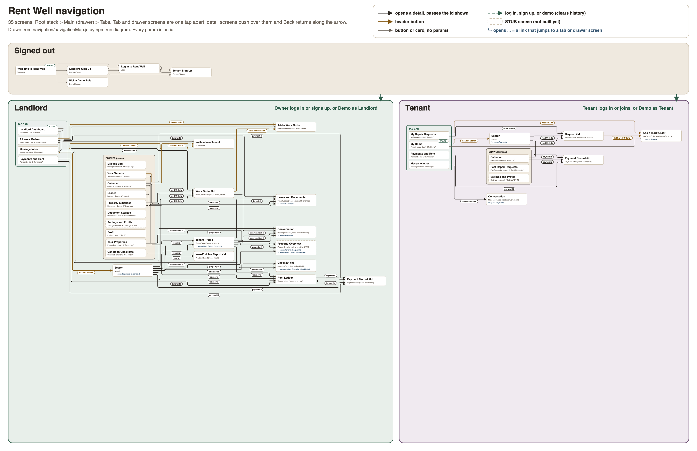

**Code:**
- `App.js` registers every screen on its navigator: `Stack.Screen`, `Drawer.Screen`, or `Tab.Screen`. The header titles and the shared styles for the stack, the tab bar, and the drawer are in `navigation/screenOptions.js`.
- `navigation/navigationMap.js` is the source of truth (each screen's `place`: auth, tab, drawer, or drill), and `navigation/hubRouter.js` lets any screen still navigate to a tab or drawer screen by name.
- Every screen is exported from `screens/index.js`. The files themselves live in `features/<feature>/screens/`.

**Screens** (35). Every param is an id, never an object:

| Header title | Route | Who | Params |
| --- | --- | --- | --- |
| Welcome to Rent Well | `Welcome` | Signed out | none |
| Pick a Demo Role | `DemoChooser` | Signed out | none |
| Log In to Rent Well | `Login` | Signed out | none |
| Landlord Sign Up | `RegisterOwner` | Signed out | none |
| Tenant Sign Up | `RegisterTenant` | Signed out | none |
| Landlord Dashboard | `Dashboard` | Landlord | none |
| All Work Orders | `WorkOrders` | Landlord | `tenantId`, `propertyId` |
| Work Order | `WorkOrderDetail` | Landlord | `workOrderId` |
| Your Tenants | `Tenants` | Landlord | `propertyId` |
| Tenant Profile | `TenantDetail` | Landlord | `tenantId` |
| Lease and Documents | `TenantLease` | Landlord | `tenancyId` or `tenantId` |
| Leases | `Leases` | Landlord | none |
| Profit | `Profit` | Landlord | none |
| Your Properties | `Properties` | Landlord | none |
| Property Overview | `PropertyDetail` | Landlord | `propertyId` |
| Invite a New Tenant | `InviteTenant` | Landlord | none |
| Document Storage | `Documents` | Landlord | none |
| Condition Checklists | `Checklist` | Landlord | none |
| Checklist | `ChecklistDetail` | Landlord | `checklistId` |
| Property Expenses | `Expenses` | Landlord | `expenseId` |
| Mileage Log | `Mileage` | Landlord | none |
| Year-End Tax Report | `YearEndReport` | Landlord | `yearId` |
| My Home | `TenantHome` | Tenant | none |
| My Repair Requests | `MyRequests` | Tenant | none |
| Request | `RequestDetail` | Tenant | `workOrderId` |
| Past Repair Requests | `PastRequests` | Tenant | none |
| Add a Work Order (Edit Work Order when it has an id) | `NewWorkOrder` | Both | `workOrderId` (only when editing) |
| Message Inbox | `Messages` | Both | none |
| Conversation | `MessageThread` | Both | `conversationId` |
| Payments and Rent | `Payments` | Both | none |
| Rent Ledger | `TenantLedger` | Landlord | `tenancyId` |
| Payment Record | `PaymentDetail` | Both | `paymentId` |
| Settings and Profile | `Settings` | Both | none |
| Calendar | `Calendar` | Both | none |
| Search | `Search` | Both | none |


## Work order form (course assignment)

One validated form adds and edits a work order, built like the lecture's ManageExpense: `components/forms/Input.js`, `features/workOrders/components/WorkOrderForm.js`, and `features/workOrders/screens/NewWorkOrderScreen.js`, with the rules in `features/workOrders/utils/workOrderValidation.js`.

- What it collects and the rules: [ASSIGNMENT_FORM.md](ASSIGNMENT_FORM.md)
- To try it: in the demo, open Work Orders and tap the add button (landlord), or Report an Issue (tenant). The pencil on a work order opens the same form to edit it.
- The tests: `features/workOrders/utils/workOrderValidation.test.js`, `features/workOrders/components/WorkOrderForm.test.js`, `features/workOrders/screens/NewWorkOrderScreen.test.js`, and `navigation/workOrderForm.test.js`

## Shared state (course assignment)

Work orders are the shared state. One `WorkOrdersProvider` (React Context, `store/WorkOrdersContext.js`) wraps the whole navigator in `App.js`, and every screen reads it with `useWorkOrders()`, so a status change on Work Order Detail shows at once on the Work Orders list, the Home subtitle, the tab badge, a tenant's profile, and the tenant's own Repairs list.

- The short explanation: [ASSIGNMENT_STATE.md](ASSIGNMENT_STATE.md)
- Which screens change it and which show it: [docs/shared-state.md](docs/shared-state.md)
- The tests that prove it: `navigation/sharedState.test.js` (the real navigators), `store/firebaseProviders.test.js` and `navigation/firebaseFlows.test.js` (Firebase mode)
