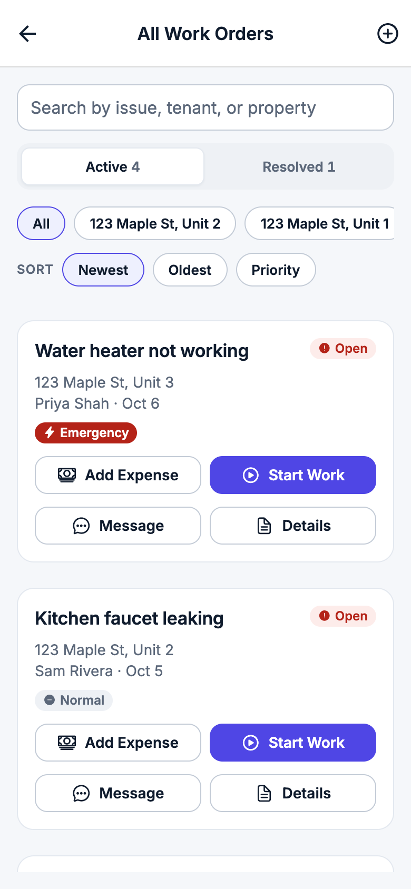
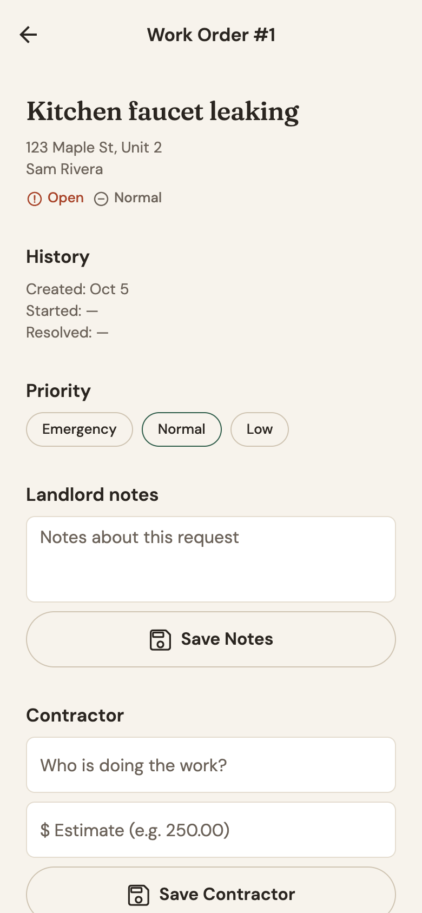
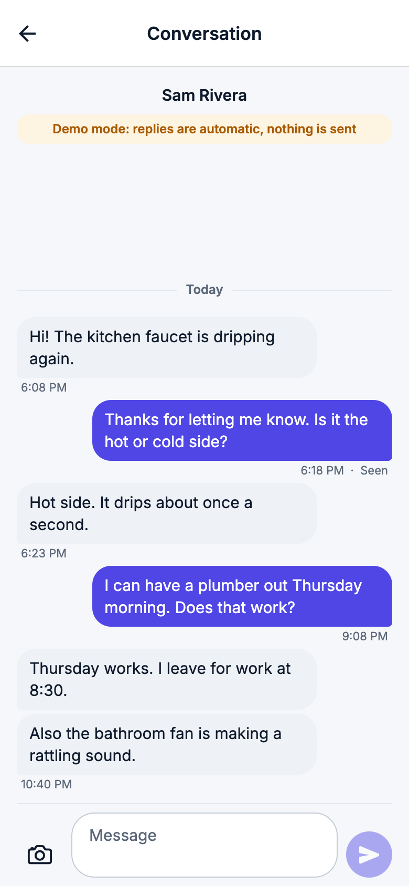
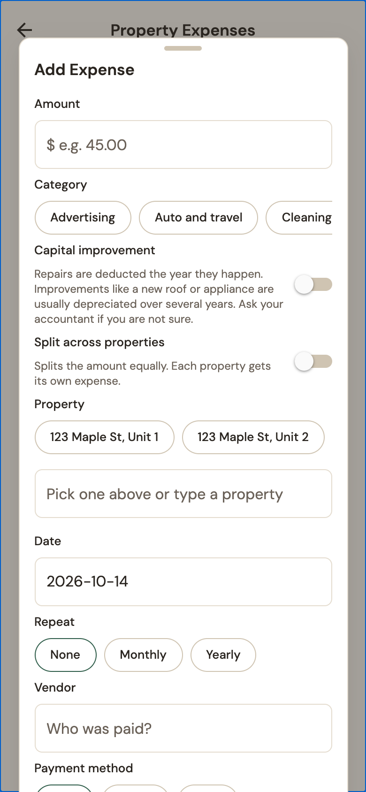
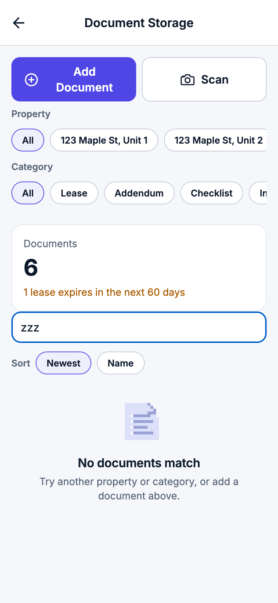
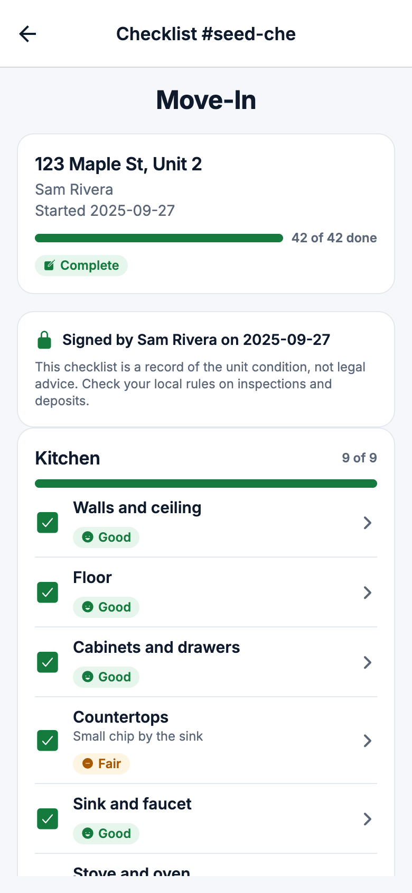
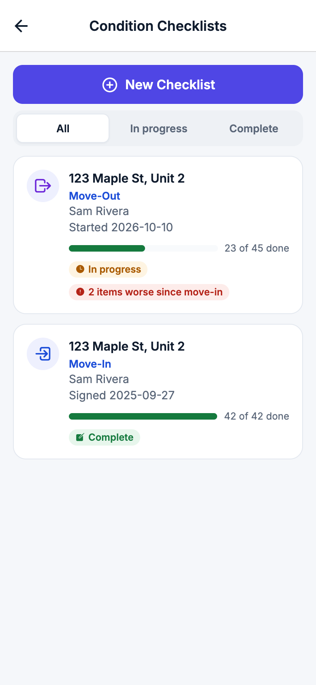
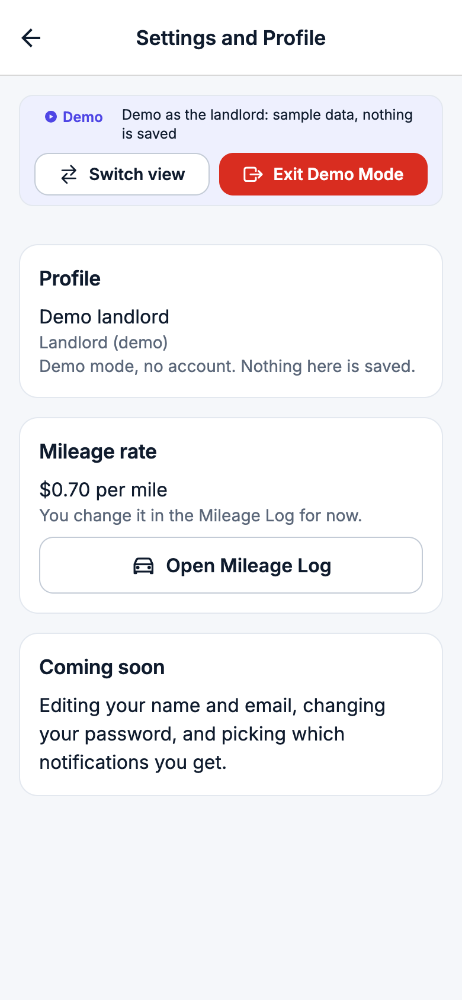

# Rent Well design system

The fintech look on branch `fintech-polish`: calm, light, and confident, like a modern banking app. Everything comes from `theme.js` and `components/ui/`, so a new screen should only need those two places. `CLAUDE.md` has the short version, this is the full guide.

## Look and feel

- White cards on a soft cool gray, ink navy text, slate secondary text, and one indigo brand color for the main action.
- Hairline borders instead of shadows. Only floating things (the indigo summary card, sheets, a selected tab) get a soft shadow.
- Corners are 12 (fields, buttons, small cards) or 16 (cards and tiles), pills are fully round.
- Spacing is a 4 point rhythm (`SPACING`), with 16 between stacked cards and 16 of side padding on every screen.
- Green means positive money or success, amber means a warning, red means danger or overdue. Nothing else uses those colors.

| Light Welcome | Landlord overview | Tenant overview |
| --- | --- | --- |
|  |  |  |

## Tokens (`theme.js`)

### Colors

- Brand: `cta` and `primary` are indigo `#4F46E5` (white text on it is 6.29 to 1), `cta_pressed` `#4338CA`, `brand_tint` `#EEF0FE`, `on_brand_muted` for quieter text on the indigo card.
- Base: `background` `#F5F7FA`, `surface` `#FFFFFF`, `surface_raised` `#F1F4F8`, `surface_sunken` `#F8FAFC`, `border` `#E3E8EF`, `border_strong` `#C3CBD6`, `text` and `title` `#0F1B2D`, `text_muted` `#5B6779`.
- States come in threes: a fill for buttons and solid pills (white text), a `_text` color for words and icons on white, and a `_tint` for soft pills and banners.

Every text and background pair the app uses, with its WCAG contrast ratio (AA is 4.5, the tests fail anything lower):

| Text | Background | Ratio |
| --- | --- | --- |
| `text` #0F1B2D | `background` #F5F7FA | 16.11 |
| `text` #0F1B2D | `surface` #FFFFFF | 17.28 |
| `text` #0F1B2D | `surface_raised` #F1F4F8 | 15.67 |
| `text_muted` #5B6779 | `background` #F5F7FA | 5.34 |
| `text_muted` #5B6779 | `surface` #FFFFFF | 5.74 |
| `text_muted` #5B6779 | `surface_raised` #F1F4F8 | 5.2 |
| `cta` #4F46E5 | `background` #F5F7FA | 5.86 |
| `cta` #4F46E5 | `surface` #FFFFFF | 6.29 |
| `cta` #4F46E5 | `surface_raised` #F1F4F8 | 5.7 |
| `success_text` #157A3E | `background` #F5F7FA | 5.04 |
| `success_text` #157A3E | `surface` #FFFFFF | 5.41 |
| `success_text` #157A3E | `surface_raised` #F1F4F8 | 4.9 |
| `info_text` #1D4ED8 | `background` #F5F7FA | 6.24 |
| `info_text` #1D4ED8 | `surface` #FFFFFF | 6.7 |
| `info_text` #1D4ED8 | `surface_raised` #F1F4F8 | 6.07 |
| `accent_text` #6D28D9 | `background` #F5F7FA | 6.62 |
| `accent_text` #6D28D9 | `surface` #FFFFFF | 7.1 |
| `accent_text` #6D28D9 | `surface_raised` #F1F4F8 | 6.44 |
| `warning_text` #A95A00 | `background` #F5F7FA | 4.72 |
| `warning_text` #A95A00 | `surface` #FFFFFF | 5.06 |
| `warning_text` #A95A00 | `surface_raised` #F1F4F8 | 4.59 |
| `danger_text` #B42318 | `background` #F5F7FA | 6.13 |
| `danger_text` #B42318 | `surface` #FFFFFF | 6.57 |
| `danger_text` #B42318 | `surface_raised` #F1F4F8 | 5.96 |
| `success_text` #157A3E | `success_tint` #E7F6EC | 4.84 |
| `info_text` #1D4ED8 | `info_tint` #EAF1FE | 5.91 |
| `accent_text` #6D28D9 | `accent_tint` #F2ECFE | 6.16 |
| `warning_text` #A95A00 | `warning_tint` #FEF4E2 | 4.64 |
| `danger_text` #B42318 | `danger_tint` #FDECEA | 5.75 |
| `text_muted` #5B6779 | `neutral_tint` #EEF1F5 | 5.06 |
| `cta` #4F46E5 | `brand_tint` #EEF0FE | 5.55 |
| `text_light` #FFFFFF | `cta` #4F46E5 | 6.29 |
| `text_light` #FFFFFF | `cta_pressed` #4338CA | 7.9 |
| `text_light` #FFFFFF | `success` #157A3E | 5.41 |
| `text_light` #FFFFFF | `action` #2563EB | 5.17 |
| `text_light` #FFFFFF | `accent` #7C3AED | 5.7 |
| `text_light` #FFFFFF | `danger` #D92D20 | 4.83 |
| `text_light` #FFFFFF | `secondary` #5B6779 | 5.74 |
| `text_light` #FFFFFF | `priority_emergency` #B42318 | 6.57 |
| `text_light` #FFFFFF | `priority_low` #0E7490 | 5.36 |
| `text_light` #FFFFFF | `tag_billed` #0F766E | 5.47 |
| `text_light` #FFFFFF | `tag_recurring` #475569 | 7.58 |
| `text_light` #FFFFFF | `tag_missing_receipt` #A95A00 | 5.06 |
| `text_light` #FFFFFF | `toast_background` #0F1B2D | 17.28 |
| `on_brand_muted` #E0E4FD | `cta` #4F46E5 | 5 |
| `on_light` #0F1B2D | `warning` #F79009 | 7.36 |
| `on_light` #0F1B2D | `highlight` #FACC15 | 11.29 |

### Type (`TYPE`, Inter only)

| Name | Use | Size / line height |
| --- | --- | --- |
| `figure` | the big number on a summary card, an invite code | 36 / 44 bold |
| `display` | page totals (deductible expenses, mileage) | 32 / 40 bold |
| `title` | greetings, a detail screen's subject | 24 / 30 bold |
| `heading` | card titles | 17 / 24 semibold |
| `subheading` | row titles, amounts in rows | 15 / 21 semibold |
| `body` | paragraphs | 16 / 24 |
| `body_compact` | message bubbles | 15 / 21 |
| `body_small` | row details | 14 / 20 |
| `label` | field labels, chip text | 13 / 18 semibold |
| `overline` | small uppercase section labels | 12 / 16 semibold, uppercase |
| `caption` | captions under figures | 12 / 16 |
| `micro` | tags, message times | 11 / 15 |
| `input` | text boxes (no line height on purpose) | 16 |

Every number that lines up in a column adds `NUMBERS` (`fontVariant: ['tabular-nums']`). Money always goes through `formatCurrency` from `utils/formatCurrency.js`: `$1,234.50`, a real minus sign for negatives (`−$12.00`), and `signed` for changes (`+$40.00`). `MoneyText` draws it with tabular digits and colors negatives red.

### Everything else

- `SPACING` xxs 2, xs 4, sm 8, md 16, lg 24, xl 32, xxl 48.
- `RADIUS` sm 8, md 12, lg 16, xl 20, pill.
- `BORDER` hairline 1, thin 1.5, thick 2.
- `SHADOWS` none, low, medium, high, each with the iOS shadow props and Android elevation, all very soft.
- `SIZES` touch 44, button heights 36, 48, 56, `icon_circle` 40, avatars 40 and 56, thumbnails 56, `content_max_width` 600 (lists and homes cap at 760 on a tablet).
- `OPACITY` and `MOTION` for pressed states and the entrance animation.

## Components (`components/ui/`)

| Component | What it's for |
| --- | --- |
| `Button` | `primary` (indigo, one per card or screen), `secondary` (outlined), `tertiary` (text link), `destructive` (red), `plain`. Sizes small, medium, large, with `loading` and `disabled`. `PrimaryButton` wraps it. |
| `Card` | `flat` (default, white with a hairline border), `raised` (soft shadow), `interactive` (tappable). |
| `SummaryBlock` | The key fact on a screen: label, big figure, caption, and room for a sparkline. `brand` is the indigo overview card. |
| `KpiTile` | One key number with its icon, label, and caption. |
| `Sparkline` | A small trend line with a dot on the newest value, no axes. |
| `QuickAction` | A round shortcut with a label and an optional badge. |
| `FeatureTile` | A grid tile with an icon circle, title, and one line. |
| `ListRow` | Icon circle or avatar, title and subtitle, amount or chevron on the right, optional divider. |
| `IconCircle` | A tinted circle with an icon, by tone (brand, success, info, accent, warning, danger, neutral). |
| `StatusPill` | Tinted pill with an icon and the words, from a status name (Open, Resolved, Paid...) or a plain tone. |
| `SegmentedControl` | Gray track with a white pill, for filters that act as tabs (Active and Resolved, checklist status). |
| `Chip` | Filter or choice chips, picked ones get the brand tint and an indigo border. |
| `CurrencyInput` | A money text box with a `$` in front and the decimal pad. |
| `MoneyText` | An amount with `formatCurrency`, tabular digits, and red for negatives. |
| `Avatar`, `Badge`, `SectionHeader` | Tinted initials, the red count bubble, the uppercase section label. |
| `EmptyState`, `SkeletonList`, `ErrorState` | Empty lists (duotone pixel drawing), first loads, and offline or server errors. |
| `ModalCard`, `sheet.js` | The sheet every modal sits in, with a grab handle. |
| `Wordmark`, `PixelArt` | The house logomark and the Rent Well name, and the pixel drawings. |
| `FadeInView`, `useReduceMotion` | The short staggered entrance, and the Reduce Motion check every animation uses. |
| `listStyles.js` | Shared search box, chips, banners, rows, and field styles for screens that draw their own. |

| Lists | Detail | Thread | Sheet |
| --- | --- | --- | --- |
|  |  |  |  |

## Rules

- One primary (indigo) button per card or screen. Everything else is secondary, tertiary, or destructive.
- Status is never color only: pills always show words and an icon.
- Touch targets are at least 44 by 44. Small things get `hitSlop`, chips get 8 above and below.
- Text is AA on its background. Use the `_text` colors on white, the `_tint` with its `_text` for pills, and white only on dark fills.
- Every pressable has `accessibilityRole` and a label, and picked chips and tabs say they're selected.
- Text grows with the system font size: use `TYPE` line heights and `flexShrink`, and never fix a text box's height.
- Animations and modal transitions check `useReduceMotion()` and skip themselves when it's on.
- Money uses `formatCurrency` and `NUMBERS`. Dates stay `YYYY-MM-DD` or the short forms `formatDate` gives.
- Numbers you add to a screen come from data the screen already has in memory, never from a new request.

## Do and don't

| Do | Don't |
| --- | --- |
| Use a token for every color, size, radius, and font. | Type a hex color or a raw font size in a component. |
| Put the key number big (`figure` or `display`) and its label as an `overline`. | Make every number on a card the same size. |
| Right-align amounts in rows with tabular digits. | Center a column of amounts or use proportional digits. |
| Use tinted pills and banners for states. | Use solid orange or red blocks for routine states. |
| Lead rows with an icon circle or avatar. | Leave rows as plain stacked text. |
| Keep pixel art for the logomark and empty states, in its quiet duotone. | Use pixel art on buttons, in headings, or as decoration behind content. |
| Give cards a hairline border. | Stack heavy shadows. |

| Empty state | Checklist | Documents | Settings |
| --- | --- | --- | --- |
|  |  |  |  |

## Visual QA

The screenshots here came from rendering the demo on the web: a scratch copy of the repo outside the project, with react-native-web, react-dom, and @expo/metro-runtime installed there, tiny mocks for the native-only modules (secure store, notifications, image picker, file system, sharing, document picker, date picker), and headless Chrome taking pictures at 390 by 844, 360 by 640, and 820 by 1180. Nothing from that setup is in this repo. More pictures are in `docs/screenshots/` (Login, the demo chooser, Messages, Tenants, Expenses, Payments, a small phone Welcome, and the tablet dashboard).
