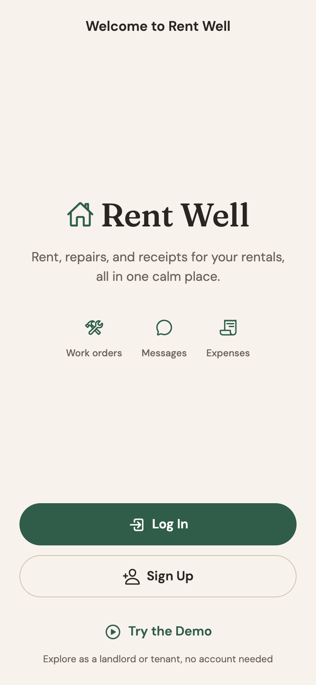
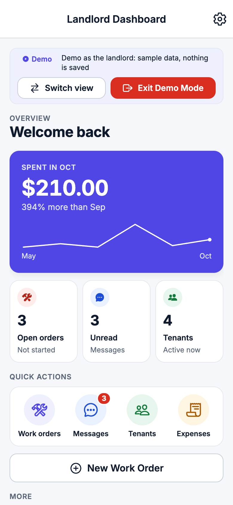
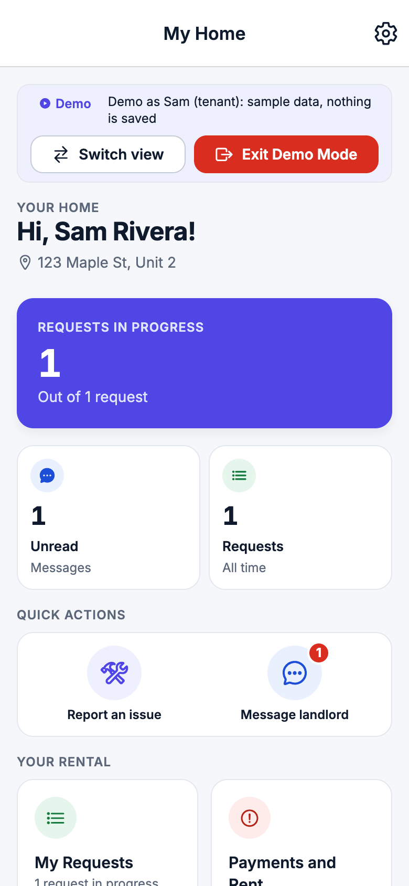
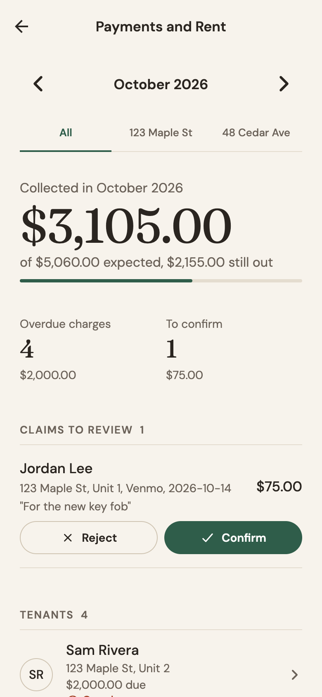
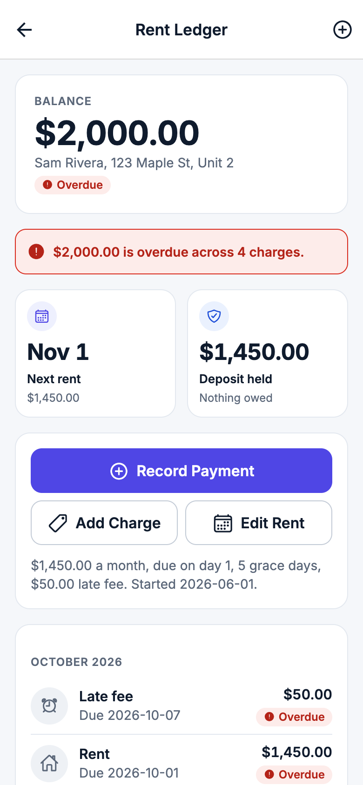
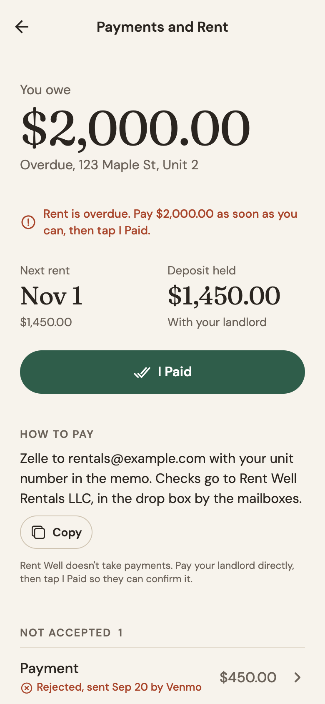
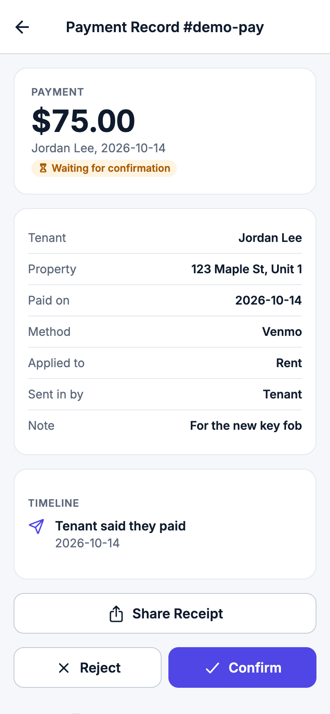

# Rent Well design system: Hearth

The Hearth look is on branch `hearth-redesign`. It should feel refined, calm, and warm, more like a quiet magazine than a tech dashboard:
- fewer boxes and more whitespace
- big, confident numbers
- hairlines instead of cards
- plain text rows with simple line icons

Everything comes from `theme.js` and `components/ui/`. `CLAUDE.md` has the short version, and this is the full guide. It replaces the indigo fintech look. The token names stayed the same, so older styles pick up the new colors.

| Welcome | Landlord overview | Tenant overview |
| --- | --- | --- |
|  |  |  |

## Look and feel

- **Paper and ink:** a warm paper background (`#F7F3EC`) with ink text (`#2A2520`) and a warm muted gray for secondary text (`#6B6259`).
- **Two accent colors only:**
  - Forest green (`#2F5D4A`) is for actions, links, progress, and good news.
  - Terracotta (`#A8442A`) is for anything overdue or urgent.
  - A warm amber (`#83560F`) is for "waiting" states.
- **No cards around lists:** rows sit on the paper with a 1pt hairline (`#E4DCCF`) on top of each row and under the last one.
- **One box type:** sheets and pop-ups are white with 12 corners. They're the only things with a shadow.
- **Big numbers in Fraunces:** a hero is 58 and a secondary figure is 30. Everything else is DM Sans.
- **Line icons only:** Ionicons outline at 24 in rows. There are no icon circles, tinted squares, or pills behind anything.
- **Spacing:** 24 of side padding on a screen, rows at least 64 tall, and a 4 point grid.

## Tokens (`theme.js`)

### Colors

| Token | Hex | Use |
| --- | --- | --- |
| `background` | `#F7F3EC` | the page and the header bar |
| `surface`, `surface_sunken` | `#FFFFFF` | inputs, sheets, pop-ups |
| `surface_raised` | `#F1EBE0` | pressed rows and buttons |
| `text`, `title` | `#2A2520` | ink |
| `text_muted` | `#6B6259` | labels, subtitles, captions, chevrons |
| `hairline`, `border` | `#E4DCCF` | row lines, input edges |
| `border_strong` | `#CFC4B2` | the outline on secondary buttons and chips |
| `cta`, `primary`, `success`, `success_text`, `focus` | `#2F5D4A` | forest green |
| `cta_pressed` | `#244A3A` | a pressed primary button |
| `danger`, `danger_text`, `priority_emergency` | `#A8442A` | terracotta |
| `warning_text` | `#83560F` | warm amber words ("Waiting for confirmation") |
| `info_text`, `accent_text` | `#3E5C76`, `#6B4E71` | quiet slate and plum, for the rare extra state |
| `toast_background` | `#2A2520` | the toast pill |
| the `_tint` colors | warm, very light | the quiet banners (offline, overdue) |

Contrast is AA (at least 4.5 to 1) for every pairing:
- `text` on `background` is 13.7, and `text_muted` is 5.4.
- Green is 6.8 on the paper, terracotta 5.4, and amber 5.75.
- White on green is 7.5.

`theme.test.js`, `components/ui/stylePairs.test.js`, and `components/ui/hearth.test.js` check every pair.

### Type (`TYPE`)

| Name | Font | Size / line | Use |
| --- | --- | --- | --- |
| `hero` | Fraunces 400 | 58 / 66 | the one big number at the top of a screen |
| `number` | Fraunces 400 | 30 / 38 | secondary figures (KPI figures) |
| `name` | Fraunces 500 | 30 / 38 | a person or property at the top of a detail screen |
| `display`, `figure` | Fraunces 400 | 32, 36 | page totals, invite codes |
| `title` | Fraunces 500 | 24 / 30 | greetings |
| `empty_title` | Fraunces 500 | 22 / 28 | empty states |
| `wordmark` | Fraunces 500 | 22 / 28 | "Rent Well" (bigger on Welcome) |
| `heading` | DM Sans 600 | 17 / 24 | header titles, form titles |
| `subheading` | DM Sans 500 | 17 / 24 | row titles, amounts in rows |
| `body` | DM Sans 400 | 16 / 24 | paragraphs |
| `body_small` | DM Sans 400 | 14 / 20 | row subtitles |
| `label` | DM Sans 500 | 13 / 18 | field labels, status words |
| `overline` | DM Sans 600 | 13 / 18, 0.08em tracking, caps | section headers |
| `button` | DM Sans 600 | 16 / 22 | button labels |

**Fonts:**
- The fonts come from `@expo-google-fonts/fraunces` and `@expo-google-fonts/dm-sans`, loaded in `App.js` with the splash screen held until they're ready.
- If they fail to load, the app still opens and the system font fills in.
- Every style keeps a line height, and nothing turns off font scaling, so text grows with the system setting.

### Spacing, radius, sizes

- **`SPACING`:** xxs 2, xs 4, sm 8, md 16, lg 24, xl 32, xxl 48, xxxl 64. Screens use `SIZES.screen_padding` (24) on the sides.
- **`RADIUS`:** sm 8 (inputs), md 12 (sheets), button 26 (every button is a full pill), pill.
- **`SIZES`:**
  - touch 44, `button_medium` 52, `row_min_height` 64
  - `row_icon` 24, `chevron` 18, `progress` 4
  - `header_avatar` 44, `content_max_width` 600
- **`SHADOWS`:** only `high` has a shadow, and only sheets use it. `low` and `medium` are flat.

## Components (`components/ui/`)

| Component | What it's for |
| --- | --- |
| `Button` | Every button is a pill, 52 tall. `primary`: green with white words (one per screen or sheet, icon on the left). `secondary`: see-through with a `border_strong` outline. `tertiary`: green words only. `destructive`: terracotta words in a terracotta outline, never a red block. |
| `ListRow` (the Row) | The main list pattern: a 24pt green line icon (or an outlined initials circle), a 17 medium title, a 14 muted subtitle (`subtitle_tone="danger"` makes it terracotta), something on the right, an 18 chevron, at least 64 tall, a hairline on top, and one under the last row. |
| `StatusLabel` | A status as a small line icon and colored words: green for paid or done, terracotta for overdue or urgent, amber for waiting, muted for neutral. It takes a status name (Open, Paid...) or a plain tone. `StatusPill` now just draws a StatusLabel. |
| `SummaryBlock` | The hero amount block: a muted label, the figure in Fraunces 58 (`size="small"` gives 30), and a muted caption, with room under it for a `ProgressLine`. No card. |
| `ProgressLine` | 4pt of green with a round end on a hairline track. |
| `KpiTile` | No tile: a muted label, a Fraunces 30 figure, and a muted caption. |
| `SectionHeader` | 13 semibold caps, 0.08em tracking, muted. |
| `SegmentedControl`, `Chip` | Tabs on a hairline with the picked one underlined in green. See-through chips with a warm outline, where the picked chip has a green edge and green words. |
| `TextField`, `CurrencyInput`, `DateField`, `listStyles.field_input` | White, a hairline edge, 8 corners, 52 tall, a muted label above, a green focus edge, and an error in terracotta with an alert icon. |
| `ModalCard`, `sheet.js` | White sheets with 12 corners, the only shadow in the app. |
| `Toast` | An ink pill with white words at the bottom, one per routine success. |
| `EmptyState` | One muted line icon, a Fraunces 22 title, a muted sentence, and one green pill. |
| `Wordmark` | "Rent Well" in Fraunces 500 next to a small green line house (`align="left"` for the dashboard's top bar). |
| `Avatar` | Initials in ink inside a hairline circle. |
| `IconCircle` | Now just the line icon in its tone color (the circle is gone). The name stayed so callers keep working. |
| `DemoBanner` | A thin green strip with white words, and two text buttons: Switch view, and Exit Demo Mode (underlined). |
| `lineIcon(name)` | Swaps a filled Ionicons name for its outline twin. |

## Rules

- **Fewer boxes:**
  - Lists are rows on the paper.
  - Groups are separated by whitespace and a section header.
  - Only a sheet is a box.
- **Status:**
  - Never only color: always a line icon and words.
  - No filled pills.
- **Numbers:**
  - The big ones are Fraunces, and money uses `NUMBERS` (tabular digits).
  - Money always goes through `formatCurrency` or `formatCents`.
- **Buttons:**
  - One primary pill per screen or sheet.
  - Anything else is secondary, tertiary (text), or destructive (outlined).
- **Accessibility:**
  - Touch targets are at least 44 by 44 (rows are 64).
  - Every pressable has a role and a label, and picked chips and tabs say so.
  - Animations and sheet transitions check `useReduceMotion()`.
- **Haptics** only on confirm and save. Routine success gets a toast.
- **Charts:** a single green line or green bars on the paper, with hairline gridlines and no card.

## Do and don't

| Do | Don't |
| --- | --- |
| Put the one number that matters in Fraunces, big, with a muted label above it. | Make a grid of tiles with icons and colored backgrounds. |
| Use hairline rows with a line icon and a chevron. | Wrap a list in a card, or put the icon in a tinted circle. |
| Show a status as an icon and colored words. | Use a filled pill or color alone. |
| Use terracotta for overdue and urgent only. | Use red blocks, or terracotta for routine things. |
| Leave whitespace between sections. | Add shadows, gradients, or borders around groups. |

## Onboarding, tours, and empty states

- **Setup checklist** (`features/home/components/OnboardingCard.js`): it shows at the top of a new landlord's Dashboard in real mode only.
  - Three ruled rows: Add a property, Invite a tenant, Set the rent.
  - A done step gets a green check, struck-through words, and "Done". A step that can't start yet shows a muted icon and says why. The step to do next has a green icon and a chevron.
  - A section header with "1 of 3", the green progress line, and a green "Hide this for good" text button.
  - It goes away once every step is done.
- **Demo tour** (`features/home/components/DemoTourSheet.js`): the standard bottom sheet. A Fraunces title, one muted line, four ruled rows each with a green line icon and a sentence, and one green "Got It" pill.
- **Empty states:** every list says what goes there in a Fraunces title and one muted sentence, with the screen's own add action as the one green pill. A list that only a server fills (Messages for a tenant, Past Requests, tenant Payments) has no button.

## Payments screens

The ledger screens follow the same rules:
- A hero balance in Fraunces.
- A muted line for the next rent and the deposit.
- One green "Record payment" pill and a secondary "More" pill (an action sheet with Add charge, Edit rent schedule, and Void).
- Months as section headers over plain rows, with the status as an icon and words ("Overdue, was due Oct 1", "Paid Sep 2 by Zelle") and the amount on the right.

| Landlord | Rent Ledger | Tenant | Payment Record |
| --- | --- | --- | --- |
|  |  |  |  |

## Visual QA

The screenshots come from rendering the demo on the web in a scratch copy of the repo outside the project:
- react-native-web, react-dom, and @expo/metro-runtime are installed there.
- Tiny mocks stand in for the native-only modules.
- Headless Chrome takes the pictures at 390 by 844, 360 by 640, and 820 by 1180.

Nothing from that setup is in this repo.
