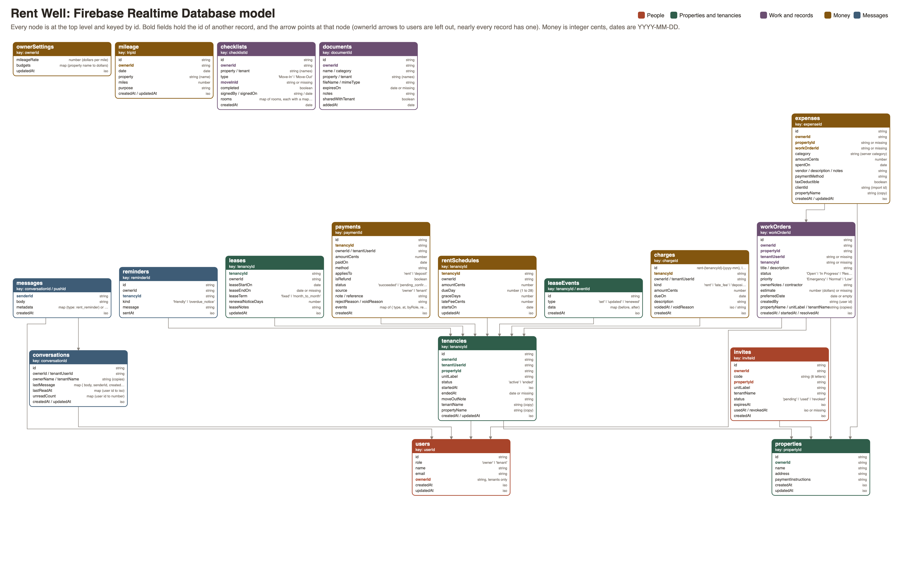

# Rent Well data model (Firebase Realtime Database)

Rent Well stores its data in one Firebase Realtime Database, read and written through the REST
endpoints only (`https://<project>-default-rtdb.firebaseio.com/<path>.json`). Every call goes
through `util/http.js`, which re-exports one module per resource from `util/data/`.



The diagram is drawn from `scripts/dataModel.mjs` with `npm run data-model`, so it always matches
the list below. ([SVG version](data-model.svg))

## Design rules

- **Flat tree.** Every node sits at the top level. A record never holds another kind of record.
  Records point at each other by id (`ownerId`, `tenancyId`, `propertyId`, and so on).
- **Keyed by id.** Each record's key is its `id`. New records get a Firebase push id from a `POST`,
  except where the key has a meaning of its own:
  - `leases/{tenancyId}` and `rentSchedules/{tenancyId}`: one per tenancy.
  - `ownerSettings/{ownerId}`: one per landlord.
  - Rent and late fee charges use the ledger's own ids, which come from the tenancy and the month:
    `charges/rent-{tenancyId}-{yyyy-mm}` and `charges/late-rent-{tenancyId}-{yyyy-mm}`. They are
    created with a conditional `PUT` (`if-match: null_etag`), so a record that already exists is
    never overwritten and running the rent catch-up twice, or on two phones, can never double charge.
  - `messages/{conversationId}/{pushId}`: push ids sort oldest to newest, so a thread reads in order.
- **Scoped by owner.** Nearly every record has `ownerId` (the landlord's user id). Records a tenant
  sees also carry `tenantUserId` and usually `tenancyId`. The app reads a whole small node and
  filters on the phone by these fields. It never uses REST queries (`orderBy`, `equalTo`), since
  those need `.indexOn` rules, so `database.rules.json` has none.
- **Copies for display.** Records carry the names a list needs (`propertyName`, `unitLabel`,
  `tenantName`), so a list renders from one read with no joins. When a property is renamed, the
  copies on its tenancies are updated in the same multi-path `PATCH`.
- **No arrays.** Firebase turns arrays into objects with numbered keys, so lists inside a record
  (checklist rooms and items, payment events) are stored as keyed objects and turned back into
  lists by `util/data/records.js`.
- **Money is integer cents** (`amountCents`) everywhere except the work order `estimate` and the
  mileage rate, which the app always kept in dollars.
- **Dates** are date-only `YYYY-MM-DD` text (`dueOn`, `paidOn`, `spentOn`). Moments in time are
  ISO timestamps (`createdAt`, `updatedAt`). Nothing is shifted between time zones.
- **No files.** The Realtime Database can't hold file bytes, so photos, receipts, and document
  files stay out of it until Firebase Storage is added. Documents and checklist items save their
  records only.

## The tree

Field types: `string`, `number`, `boolean`, `date` (YYYY-MM-DD), `iso` (timestamp), `map` (keyed
object). `(copy)` marks a display copy of a name stored elsewhere.

```jsonc
{
  "users": {
    "{userId}": {
      "id": "string",
      "role": "owner | tenant",
      "name": "string",
      "email": "string",
      "ownerId": "string (tenants only: their landlord)",
      "createdAt": "iso", "updatedAt": "iso"
    }
  },
  "properties": {
    "{propertyId}": {
      "id": "string", "ownerId": "string -> users",
      "name": "string", "address": "string",
      "paymentInstructions": "string",
      "createdAt": "iso", "updatedAt": "iso"
    }
  },
  "tenancies": {
    "{tenancyId}": {
      "id": "string",
      "ownerId": "string -> users",
      "tenantUserId": "string -> users",
      "propertyId": "string -> properties",
      "unitLabel": "string",
      "status": "active | ended",
      "startedAt": "iso", "endedAt": "date (ended only)",
      "moveOutNote": "string",
      "tenantName": "string (copy)", "propertyName": "string (copy)",
      "createdAt": "iso", "updatedAt": "iso"
    }
  },
  "leases": {
    "{tenancyId}": {
      "tenancyId": "string -> tenancies", "ownerId": "string",
      "leaseStartOn": "date", "leaseEndOn": "date (missing for month to month)",
      "leaseTerm": "fixed | month_to_month",
      "renewalNoticeDays": "number", "leaseNotes": "string",
      "updatedAt": "iso"
    }
  },
  "leaseEvents": {
    "{tenancyId}": {
      "{eventId}": { "id": "string", "type": "set | updated | renewed", "data": "map", "createdAt": "iso" }
    }
  },
  "invites": {
    "{inviteId}": {
      "id": "string", "ownerId": "string -> users",
      "code": "string (8 letters, unique)",
      "propertyId": "string -> properties", "propertyName": "string (copy)",
      "unitLabel": "string", "tenantName": "string",
      "status": "pending | used | revoked",
      "expiresAt": "iso", "usedAt": "iso", "revokedAt": "iso", "createdAt": "iso"
    }
  },
  "workOrders": {
    "{workOrderId}": {
      "id": "string", "ownerId": "string -> users",
      "propertyId": "string -> properties",
      "tenantUserId": "string -> users (optional)", "tenancyId": "string -> tenancies (optional)",
      "title": "string", "description": "string",
      "status": "Open | In Progress | Resolved",
      "priority": "Emergency | Normal | Low",
      "ownerNotes": "string", "contractor": "string", "estimate": "number (dollars, optional)",
      "preferredDate": "date or empty",
      "createdBy": "string -> users",
      "propertyName": "string (copy)", "propertyAddress": "string (copy)",
      "unitLabel": "string", "tenantName": "string (copy)",
      "createdAt": "iso", "startedAt": "iso", "resolvedAt": "iso", "updatedAt": "iso"
    }
  },
  "expenses": {
    "{expenseId}": {
      "id": "string", "ownerId": "string -> users",
      "propertyId": "string -> properties (optional)", "propertyName": "string (copy)",
      "workOrderId": "string -> workOrders (optional)",
      "category": "repairs | insurance | utilities | ... (Schedule E lines)",
      "amountCents": "number", "spentOn": "date",
      "vendor": "string", "description": "string", "notes": "string",
      "paymentMethod": "credit_card | check | zelle | ...",
      "taxDeductible": "boolean (false for capital improvements)",
      "clientId": "string (the phone's old id, so an import never doubles)",
      "createdAt": "iso", "updatedAt": "iso"
    }
  },
  "mileage": {
    "{tripId}": {
      "id": "string", "ownerId": "string -> users",
      "date": "date", "property": "string (name)", "miles": "number", "purpose": "string",
      "createdAt": "iso", "updatedAt": "iso"
    }
  },
  "ownerSettings": {
    "{ownerId}": { "mileageRate": "number", "budgets": "map (property name -> dollars)", "updatedAt": "iso" }
  },
  "rentSchedules": {
    "{tenancyId}": {
      "tenancyId": "string -> tenancies", "ownerId": "string", "tenantUserId": "string",
      "amountCents": "number", "dueDay": "number (1 to 28)", "graceDays": "number",
      "lateFeeCents": "number", "startsOn": "date", "updatedAt": "iso"
    }
  },
  "charges": {
    "{chargeId}": {
      "id": "string", "tenancyId": "string -> tenancies",
      "ownerId": "string", "tenantUserId": "string",
      "kind": "rent | late_fee | deposit | other",
      "amountCents": "number", "dueOn": "date", "description": "string",
      "voidedAt": "iso (voided only)", "voidReason": "string",
      "createdAt": "iso"
    }
  },
  "payments": {
    "{paymentId}": {
      "id": "string", "tenancyId": "string -> tenancies",
      "ownerId": "string", "tenantUserId": "string",
      "amountCents": "number", "paidOn": "date", "method": "string",
      "appliesTo": "rent | deposit", "isRefund": "boolean",
      "status": "succeeded | pending_confirmation | rejected | voided",
      "source": "owner | tenant",
      "note": "string", "reference": "string",
      "rejectReason": "string", "voidReason": "string",
      "events": { "{eventKey}": { "type": "string", "at": "iso", "byRole": "owner | tenant", "reason": "string" } },
      "createdAt": "iso"
    }
  },
  "conversations": {
    "{conversationId}": {
      "id": "string", "ownerId": "string -> users", "tenantUserId": "string -> users",
      "ownerName": "string (copy)", "tenantName": "string (copy)",
      "lastMessage": { "body": "string", "senderId": "string", "createdAt": "iso" },
      "lastReadAt": { "{userId}": "iso" },
      "unreadCount": { "{userId}": "number" },
      "createdAt": "iso", "updatedAt": "iso"
    }
  },
  "messages": {
    "{conversationId}": {
      "{pushId}": {
        "senderId": "string -> users", "body": "string",
        "metadata": { "type": "rent_reminder", "kind": "friendly | overdue_notice" },
        "createdAt": "iso"
      }
    }
  },
  "reminders": {
    "{reminderId}": {
      "id": "string", "ownerId": "string", "tenancyId": "string -> tenancies",
      "kind": "friendly | overdue_notice", "message": "string", "sentAt": "iso"
    }
  },
  "checklists": {
    "{checklistId}": {
      "id": "string", "ownerId": "string -> users",
      "property": "string (name)", "tenant": "string (name)",
      "type": "Move-In | Move-Out", "moveInId": "string -> checklists (optional)",
      "completed": "boolean", "signedBy": "string", "signedOn": "date",
      "createdAt": "date",
      "rooms": {
        "{roomKey}": {
          "id": "string", "name": "string",
          "items": {
            "{itemKey}": {
              "id": "string", "name": "string", "done": "boolean",
              "condition": "Good | Fair | Poor (optional)", "note": "string",
              "moveInCondition": "string (optional)", "moveInNote": "string"
            }
          }
        }
      }
    }
  },
  "documents": {
    "{documentId}": {
      "id": "string", "ownerId": "string -> users",
      "name": "string", "category": "Lease | Addendum | Insurance | ...",
      "property": "string (name)", "tenant": "string (name)",
      "fileName": "string", "mimeType": "string",
      "expiresOn": "date (leases and addenda)", "notes": "string",
      "sharedWithTenant": "boolean", "addedAt": "date"
    }
  }
}
```

## Who reads and writes each node

| Node | Read by (screens) | Written by |
| --- | --- | --- |
| `users` | Login (test accounts), Tenants, Tenant Profile, Messages | Register Landlord, Register Tenant |
| `properties` | Properties, Property Overview, Tenants, Invite Tenant, work order form, Expenses | Properties (add, edit, delete), Property Overview (payment instructions) |
| `tenancies` | Tenants, Tenant Profile, Leases, Tenant Lease, Payments, tenant Home, Calendar | Assign, Move, End (Tenant Profile), Register Tenant |
| `leases`, `leaseEvents` | Leases, Tenant Lease, both Homes, Calendar | Tenant Lease (set, edit, renew) |
| `invites` | Invite Tenant, Tenants (pending), Register Tenant (code check) | Invite Tenant (create, resend, revoke), Register Tenant (marks used) |
| `workOrders` | Work Orders, Work Order, My Requests, Request, Past Requests, Tenant Profile, Dashboard, Search, Calendar | Work order form (add, edit), Work Order (start, resolve, priority, notes, contractor, delete) |
| `expenses` | Expenses, Year-End Report, Profit, Work Order (its expenses) | Expense form (add, edit, delete), the phone import card |
| `mileage` | Mileage, Year-End Report | Mileage (add, edit, delete) |
| `ownerSettings` | Mileage, Expenses (budgets) | Settings (mileage rate), Expenses (budgets) |
| `rentSchedules` | Payments, Rent Ledger, Calendar | Rent Ledger (rent schedule), Tenant Lease (renew with new rent) |
| `charges`, `payments` | Payments, Rent Ledger, Payment Record, both Homes, Profit, Calendar | Rent Ledger (record, charge, void), Payments ("I Paid"), Payment Record (confirm, reject, void), the rent catch-up |
| `conversations`, `messages` | Messages, Message thread, tab badge, both Homes | Message thread (send, read), rent reminders |
| `reminders` | Rent reminder sheet (the 24 hour rule) | Rent reminder sheet (send) |
| `checklists` | Checklists, Checklist, Tenant Profile (move-out offer) | Checklists (new, delete), Checklist (items, rooms, sign) |
| `documents` | Documents | Documents (add, edit, delete) |

## What stays on the phone

These are per device preferences, not shared data, so they stay in AsyncStorage or SecureStore:

- Appearance (System, Light, Dark), the Face ID unlock switch, and the demo tour flag.
- The signed-in test account's user id (`rent_well_test_account`), until Firebase Auth replaces it.
- Recent searches, the device calendar ids, and the dismissed onboarding card.
- Cached copies of work orders, expenses, and ledgers, so a screen still shows the last data offline.
- Recurring expense rules (the Recurring button is hidden in Firebase mode until it moves over).
- The demo, which is fully local and never touches the database.

## Server jobs that became catch-up runs

The old server billed rent and late fees on a timer. With no server, the landlord's phone runs the
same rules (`syncLedger` in `features/payments/utils/ledgerMath.js`) when the app opens, on pull to
refresh of Payments, and after a rent schedule change. Every charge it makes has a deterministic id
and is created with `createIfAbsent`, a conditional `PUT` that fails with 412 when the record is
already there, so the run is safe to repeat.
