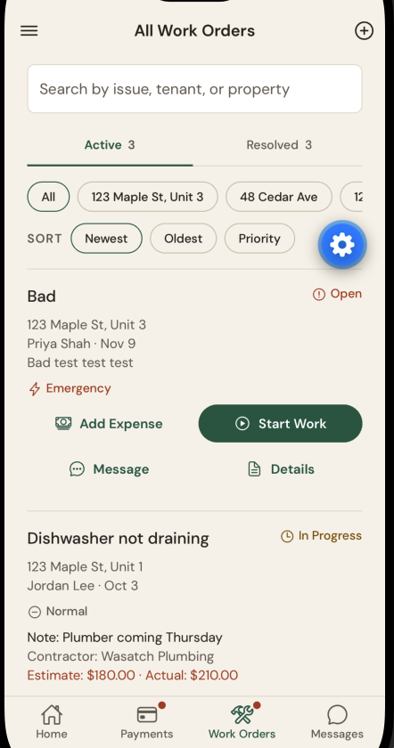
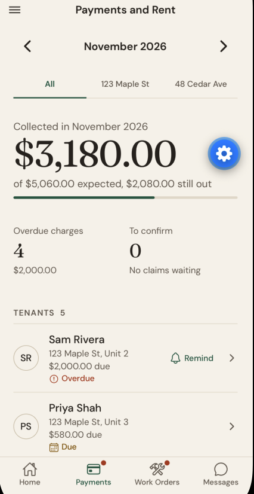

# Rent Well

## Milestone 2

### Screens Implemented

A `*` after a name means the screen is fully implemented: the layout is complete, and it reads or writes
the Firebase Realtime Database with loading and error handling. The full coverage matrix (what each
screen reads, writes, and shows while loading, on an error, and when empty) is in
[progress-log-milestone2.md](progress-log-milestone2.md#screen-coverage-matrix). 32 of the 35
screens are fully implemented.

**Signed out**

- **Welcome to Rent Well:** the first screen, with Log In, Sign Up, and the demo, so a new person knows
  where to start.
- **Pick a Demo Role:** chooses the landlord or tenant side of the offline demo, so the app can be shown
  without an account or a network.
- **Log In to Rent Well \*:** lists the test accounts in the database and signs in as the one I pick,
  standing in for real sign in until Firebase Auth next milestone.
- **Landlord Sign Up \*:** creates a landlord test account in `users` and signs in as it.
- **Tenant Sign Up \*:** checks an invite code against `invites`, then creates the tenant, their
  tenancy, and their conversation with the landlord in one write.

**Landlord**

- **Landlord Dashboard \*:** rent collected this month, who is behind, leases ending, and counts for
  every section, so the landlord sees what needs attention first. Opening it also bills any rent that
  came due.
- **All Work Orders \*:** every repair request with search, filters, and sort, so nothing gets lost.
- **Work Order \*:** one request's details, status (Start Work, Mark Resolved), priority, notes,
  contractor, estimate, its expenses, Edit, and Delete.
- **Add a Work Order \*:** the validated form that adds or edits a work order for both roles.
- **Your Tenants \*:** tenants grouped by property and unit, pending invites with Resend and Revoke,
  and past tenants, so the landlord knows who lives where.
- **Tenant Profile \*:** one tenant's contact, homes, work orders, and history, with Message, Move,
  Assign, and End Tenancy.
- **Lease and Documents \*:** one tenancy's lease with Set, Edit, and Renew, and its history.
- **Leases \*:** every lease by end date with its status, so renewals don't sneak up.
- **Your Properties \*:** add, edit, and delete properties (delete is blocked while tenants live there).
- **Property Overview \*:** one property's tenants and the payment instructions tenants see.
- **Invite a New Tenant \*:** creates an invite code for a property and unit and lists the pending ones.
- **Document Storage \*:** document records by property and category with lease end dates.
- **Condition Checklists \*:** move-in and move-out inspections and their progress.
- **Checklist \*:** one inspection's rooms and items, condition and notes, and sign-off.
- **Property Expenses \*:** expenses by category and property with budgets and CSV export, for
  Schedule E.
- **Profit \*:** net profit by month and by property, worked out from the expenses and the rent ledger,
  with a tax summary.
- **Mileage Log \*:** business trips and the mileage deduction.
- **Year-End Tax Report \*:** the year's deductible totals by property and category.
- **Rent Ledger \*:** one tenancy's balance, charges, and payments, with Record Payment, charges, the
  rent schedule, reminders, and void.

**Tenant**

- **My Home \*:** what I owe, my lease, and shortcuts, or a read-only home after my tenancy ends.
- **My Repair Requests \*:** my requests and their status, with Report an Issue.
- **Request \*:** one request's progress and the landlord's notes, with Edit while it's still Open.
- **Past Repair Requests \*:** requests from rentals I've moved out of, read only.

**Both roles**

- **Payments and Rent \*:** the landlord's month (collected, overdue, claims to confirm) or the
  tenant's balance, payment instructions, and the "I Paid" claim.
- **Payment Record \*:** one payment's timeline with confirm, reject, void, and a shareable text
  receipt.
- **Message Inbox \*:** conversations with unread counts.
- **Conversation \*:** one thread, with sending and read receipts. It checks for new messages every
  8 seconds while it is open.
- **Calendar \*:** rent due dates, payments, lease ends, and repair dates on a month grid, built from the
  data already loaded.
- **Search \*:** one search over tenants, properties, work orders, payments, and expenses already loaded.
- **Settings and Profile:** appearance, Face ID, the mileage rate, the demo tour, and Log Out. It is
  mostly device settings, so I don't count it as a Firebase screen (only the mileage rate saves there).

### Navigation Structure

The navigators are built in `App.js` from one map of every screen (`navigation/navigationMap.js`), and
every header uses the shared options in `navigation/screenOptions.js`. Only ids travel between screens
as route parameters (for example `workOrderId`, `tenancyId`, `conversationId`). The diagram is
[assignment/navigation/navigation-diagram.png](../assignment/navigation/navigation-diagram.png) (also
as a [PDF](../assignment/navigation/navigation-diagram.pdf)).

- **Root stack** (native stack)
  - Signed out: Welcome to Rent Well, Pick a Demo Role, Log In to Rent Well, Landlord Sign Up, Tenant
    Sign Up
  - **Main** (drawer, permanent on tablets)
    - **Tabs** (bottom tabs)
      - Landlord: Landlord Dashboard, Payments and Rent, All Work Orders, Message Inbox
      - Tenant: My Home, Payments and Rent, My Repair Requests, Message Inbox
    - Landlord drawer sections
      - Rentals: Your Properties, Your Tenants, Leases
      - Money: Property Expenses, Mileage Log, Profit
      - Records: Document Storage, Condition Checklists
      - Schedule: Calendar
      - Account: Settings and Profile
    - Tenant drawer sections
      - Repairs: Past Repair Requests
      - Schedule: Calendar
      - Account: Settings and Profile
  - Landlord detail screens: Work Order, Tenant Profile, Lease and Documents, Property Overview, Rent
    Ledger, Invite a New Tenant, Checklist, Year-End Tax Report
  - Tenant detail screen: Request
  - Shared detail screens: Add a Work Order, Conversation, Payment Record, Search

Each role only registers its own screens. A detail screen pushes over the tab bar, and back returns to
the tab it came from.

### Problems Encountered/Questions

- **No live updates over REST.** The Realtime Database's REST endpoints have no listener I can keep
  open in React Native, so the app can't be told when data changes. I reload a screen's data when it
  comes back into view, on pull to refresh, and after every save. An open conversation also checks for
  new messages every 8 seconds, stopping when the screen loses focus or the app goes to the background.
- **REST queries need index rules.** `orderBy` and `equalTo` only work with `.indexOn` rules, so I keep
  the tree flat, read a whole small node, and filter by `ownerId` or `tenantUserId` on the phone. That's
  fine for a landlord with a few units, and I would add indexes if the data grew.
- **No server to run scheduled work.** Rent and late fees need to be billed on a schedule, but the app
  talks straight to the database and has no server of its own. So the landlord's phone does it when the
  app opens, on pull to refresh, and after a rent schedule change. Each charge has a fixed id (the
  tenancy and the month), and it is created with a conditional write that fails if the record already
  exists, so running it twice or on two phones never double charges. I tested both cases.
- **No arrays.** Firebase turns arrays into objects with numbered keys, so checklist rooms and items and
  payment timelines are saved as keyed objects. I also found that messages need push-style keys made
  from their time, or a new message sorted as the oldest one.
- **Photos wait for Storage.** The Realtime Database can't hold files, so photo, receipt, and document
  uploads are hidden outside the demo for now. Documents and checklists save their records.
- **Sign in is a stand-in.** Until Firebase Auth next milestone, Log In picks a test account from the
  database and keeps only its id on the phone, and the sign up screens have no password.
- **Test mode rules run out.** The database is in test mode, which allows anyone to read and write and
  expires after 30 days. Next milestone I'll add Firebase Auth and rules that only let each landlord and
  tenant reach their own records.

